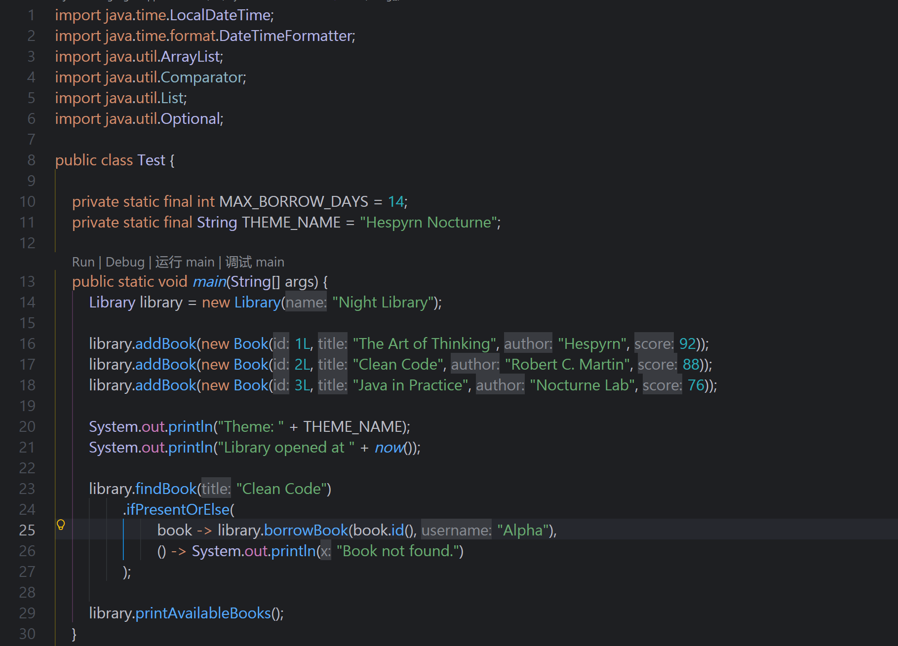
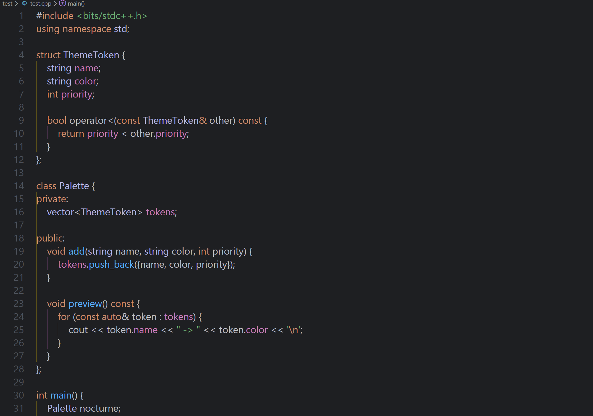
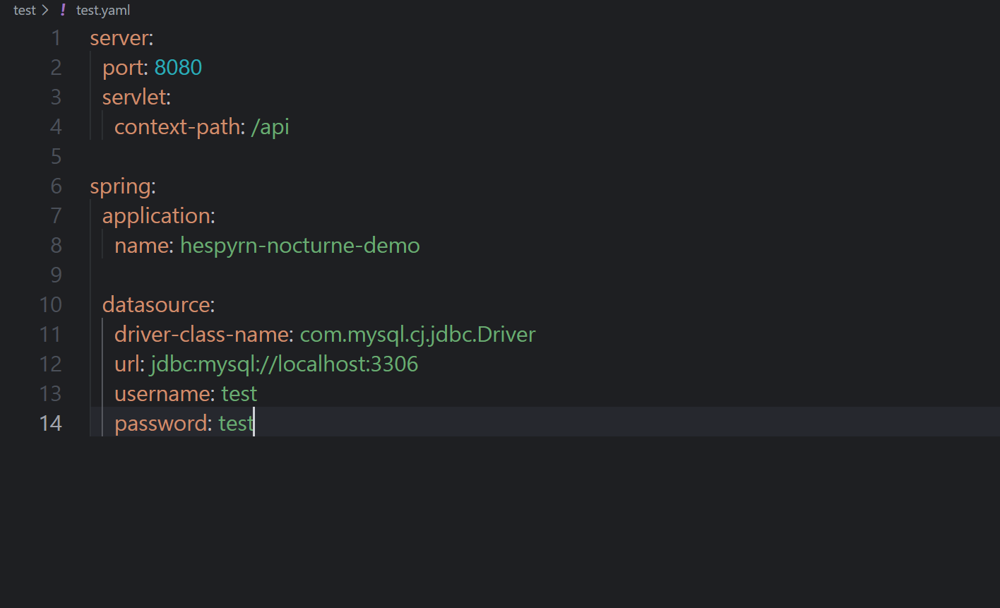

# Hespyrn Nocturne

Two dark color themes in one VS Code extension.

- **Hespyrn Nocturne** is the original palette refined from JetBrains IDEA. [Theme file](./themes/hespyrn-nocturne-1.0.1-color-theme.json)
- **Hespyrn Evernight** takes its editor, workbench, and syntax colors from Visual Studio 2026. [Theme file](./themes/hespyrn-evernight-color-theme.json)

Hespyrn Nocturne keeps the calm visual feeling of IDEA / JetBrains dark themes: a gray-black background, warm orange keywords, blue functions, green strings, and soft purple accents for types and members. It is not designed to be extremely bright or high-contrast. It is meant to feel quiet, readable, and comfortable during long coding sessions.

## Nocturne preview

### Java



### C++



### YAML



## Why I Made This Theme

I like the dark color scheme I use in JetBrains IDEA, but I could not find a VS Code theme that felt exactly right.

Many themes were either too bright, too harsh, or not quite suitable for the languages I use most, such as Java, C++, and YAML. So I converted my IDEA `.icls` color scheme into a VS Code theme and refined it directly against real code.

Some details I cared about:

- numeric literals should not become italic for no reason;
- Java import and package paths should not be colored like keywords;
- YAML keys should look like configuration keys, not ordinary strings;
- annotations, types, fields, and functions should keep a familiar IDEA-like hierarchy.

That process became **Hespyrn Nocturne**.

`Nocturne` suggests night music and night colors. The theme is meant to feel like something suitable for coding at night: quiet and low-key, but still carrying its own tone.

## Features

- IDEA-inspired dark color palette
- Comfortable low-contrast editor background
- Warm orange keywords
- Blue function and method names
- Green strings
- Soft green comments
- Purple accents for types, fields, and properties
- Cyan numeric literals
- Refined colors for Java, C++, YAML, and common web syntax
- Keeps VS Code semantic highlighting enabled for stable Java language coloring

## Installation

### Install from VSIX

1. Download the `.vsix` from [GitHub Releases](https://github.com/Hespyrn/hespyrn-nocturne/releases/latest).
2. Open VS Code.
3. Press `Ctrl + Shift + P`.
4. Run `Extensions: Install from VSIX...`.
5. Select the downloaded `.vsix` file.
6. Press `Ctrl + K Ctrl + T`.
7. Choose `Hespyrn Nocturne` or `Hespyrn Evernight`.

## Theme Info

```text
Themes: Hespyrn Nocturne, Hespyrn Evernight
Author: Hespyrn, with ChatGPT
```

## Color Palette

| Element | Nocturne | Evernight |
| --- | --- | --- |
| Editor background | `#1E1F22` | `#1E1E1E` |
| Sidebar background | `#1E1F22` | `#282828` |
| Status bar background | `#2B2D30` | `#141414` |
| Editor foreground | `#BCBEC4` | `#BCBEC4` |
| Comments | `#67A37C` | `#57A64A` |
| Class names | `#B5B6E3` | `#BEB7FF` |
| Editor selection | `#214283` | `#004377` |

## Notes

Nocturne was built from an IDEA `.icls` color scheme. Evernight maps Visual Studio syntax colors to the token types available in VS Code.

JetBrains IDEs and VS Code use different token systems, so syntax colors may not match perfectly across every language and extension. This version focuses on practical usability and overall visual consistency rather than forcing a one-to-one token mapping.

## Changelog

### 1.0.3

- Added Hespyrn Evernight as a second selectable theme in the same extension.
- Matched the Visual Studio 2026 editor background, comments, and key C++, C#, and Python syntax colors in Evernight.

### 1.0.0

- Initial release version.
- Renamed theme to `Hespyrn Nocturne`.
- Set author to `Hespyrn, with ChatGPT`.
- Added refined syntax colors for Java, C++, YAML, and common editor UI elements.
- Fixed numeric literals so they are not italic.
- Adjusted YAML key colors.
- Kept stable Java semantic highlighting behavior.

## License

Personal theme release.

You may modify it for your own use.
