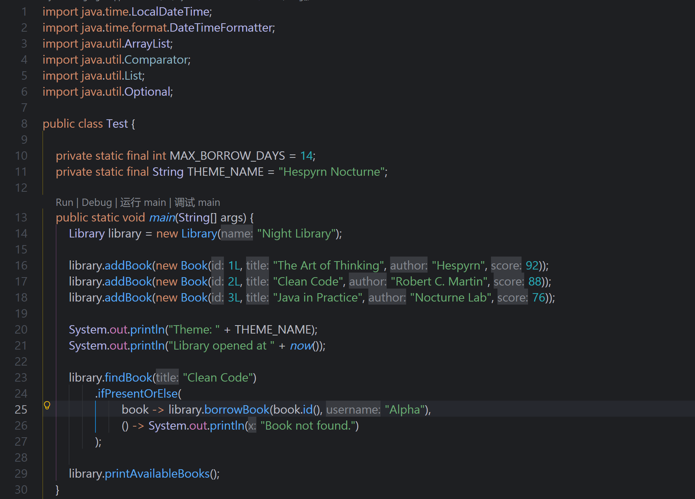
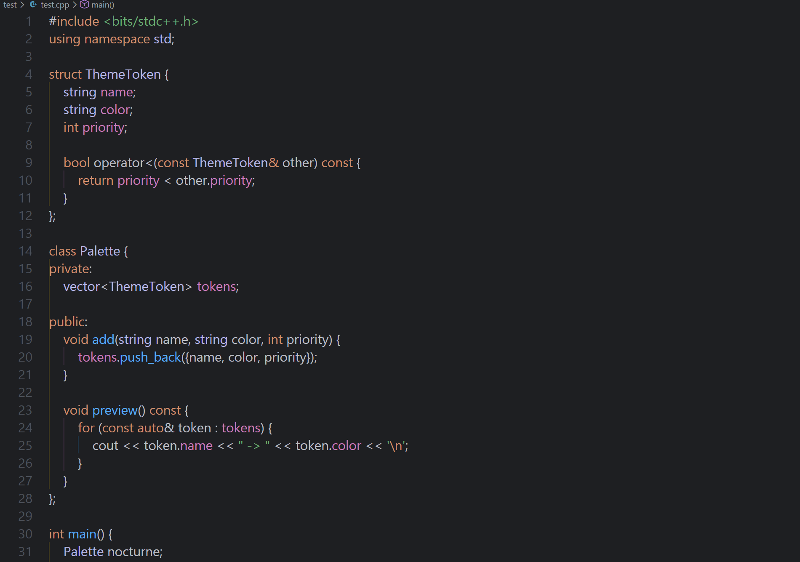
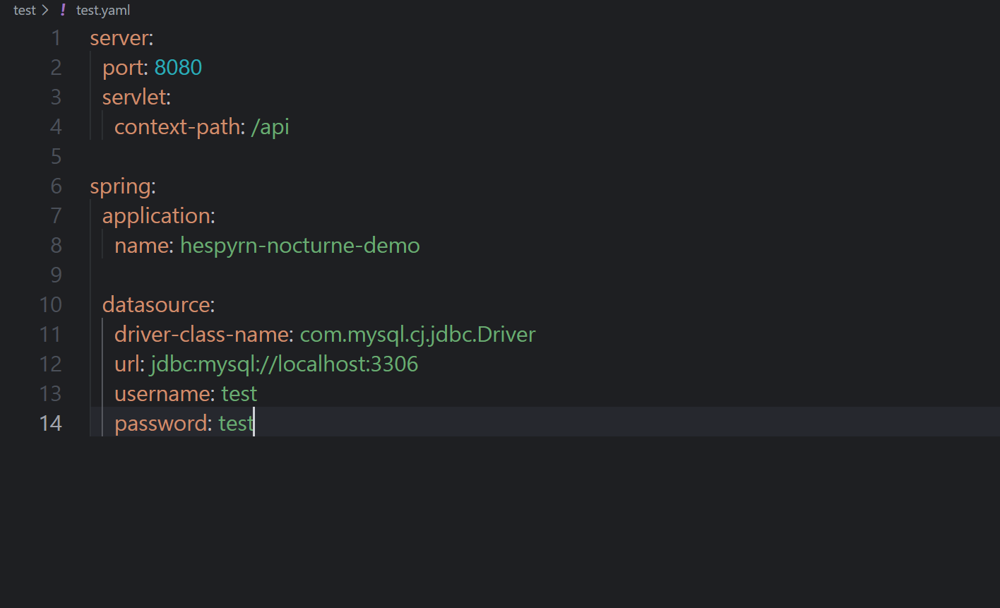

# Hespyrn Nocturne

一个包含两套深色配色的 VS Code 扩展。

- **Hespyrn Nocturne** 延续从 JetBrains IDEA 调整而来的配色。[主题文件](./themes/hespyrn-nocturne-1.0.1-color-theme.json)
- **Hespyrn Evernight（永夜）** 参考 Visual Studio 2026 的编辑区、侧栏、标签栏和语法高亮。[主题文件](./themes/hespyrn-evernight-color-theme.json)

Hespyrn Nocturne 保留了 IDEA / JetBrains 系深色主题的沉静质感：灰黑色背景、暖橙色关键字、蓝色函数、绿色字符串，以及柔和的紫色类型与成员变量。它不是一个追求强烈对比度的主题，而是希望在长时间写代码时保持舒服、清晰、安静。

## Nocturne 预览

### Java



### C++



### YAML



## 为什么做这个主题

我平时很喜欢 JetBrains IDEA 里的这套暗色观感，但在 VS Code 里一直找不到完全顺眼的替代品。

很多主题要么颜色太亮，要么对比太硬，要么 Java、C++、YAML 这些常用语言的高亮不太符合我的习惯。于是我把自己正在用的 IDEA `.icls` 配色方案转换成了 VS Code 主题，并在实际代码里一点点调整：

- 数字不应该莫名变成斜体；
- Java 的 import / package 路径不应该整片都是关键词颜色；
- YAML 的 key 需要更像配置项，而不是普通字符串；
- 注解、类型、字段、函数要尽量保持 IDEA 那种熟悉的层次感。

最后整理成了这个主题：**Hespyrn Nocturne**。

名字里的 `Nocturne` 有夜曲、夜色的意思。它更像是一套适合夜里写代码的主题：安静、低调，但仍然有一点属于自己的颜色。

## 特性

- IDEA 风格的深色配色
- 低刺激、适合长时间使用的编辑器背景
- 暖橙色关键字
- 蓝色函数与方法
- 绿色字符串
- 柔和绿色注释
- 紫色类型、字段与属性
- 青色数字字面量
- 针对 Java、C++、YAML 与常见 Web 语法做过细调
- 保留 VS Code semantic highlighting，以保证 Java 等语言的稳定高亮效果

## 安装

### 从 VSIX 安装

1. 从 [GitHub Releases](https://github.com/Hespyrn/hespyrn-nocturne/releases/latest) 下载 `.vsix`。
2. 打开 VS Code。
3. 按下 `Ctrl + Shift + P`。
4. 输入并运行 `Extensions: Install from VSIX...`。
5. 选择下载好的 `.vsix` 文件。
6. 按下 `Ctrl + K Ctrl + T`。
7. 选择 `Hespyrn Nocturne` 或 `Hespyrn Evernight`。

## 主题信息

```text
Themes: Hespyrn Nocturne, Hespyrn Evernight
Author: Hespyrn
```

## 配色表

| 元素 | Nocturne | Evernight |
| --- | --- | --- |
| 编辑器背景 | `#1E1F22` | `#1E1E1E` |
| 侧栏背景 | `#1E1F22` | `#282828` |
| 状态栏背景 | `#2B2D30` | `#141414` |
| 默认前景色 | `#BCBEC4` | `#BCBEC4` |
| 普通注释 | `#67A37C` | `#57A64A` |
| 类名 | `#B5B6E3` | `#BEB7FF` |
| 编辑器选区 | `#214283` | `#004377` |

## 注意

Nocturne 来源于 IDEA `.icls` 配色方案。Evernight 在 VS Code 中对应 Visual Studio 的语法分类。

JetBrains IDE 和 VS Code 的语法 token 体系并不完全一致，所以不同语言、不同插件下的颜色不会做到 100% 完全一致。当前版本更偏向实际可用性和整体观感，而不是强行逐项还原。

## 更新记录

### 1.0.3

- 在同一个扩展中加入 Hespyrn Evernight，安装一次即可在两套主题间切换。
- Evernight 对齐 Visual Studio 2026 的编辑区背景、注释色以及 C++、C# 和 Python 的主要语法色。

### 1.0.0

- 发布初始 Release 版本。
- 主题命名为 `Hespyrn Nocturne`。
- 调整 Java、C++、YAML 和常见编辑器 UI 配色。
- 修正数字字面量斜体问题。
- 调整 YAML key 颜色。
- 保留稳定的 Java 语义高亮行为。

## License

Personal theme release.

你可以自由修改并用于个人用途。
